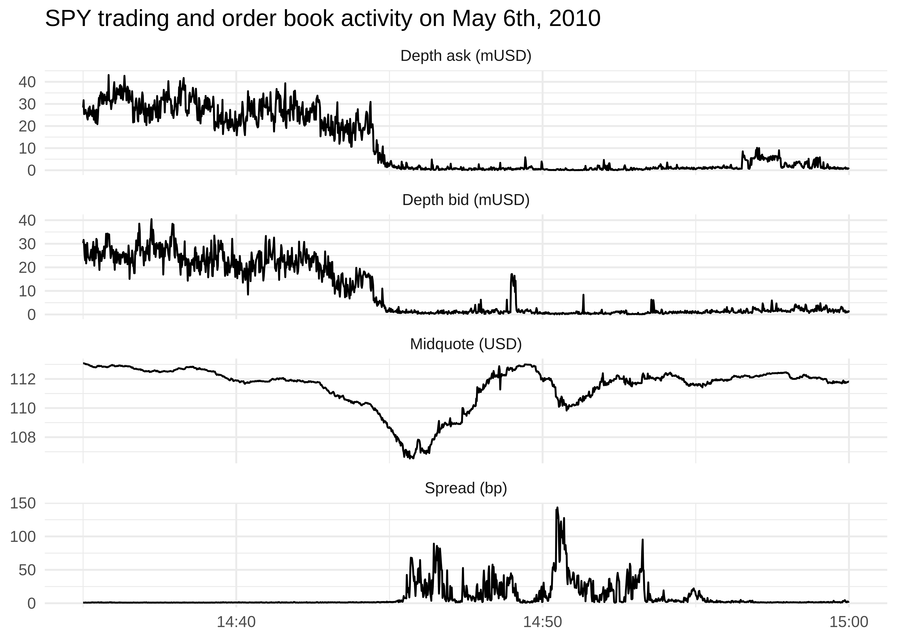

> **NOTE:**
>
> A review of the cleaning code in the first version of this post found several errors. Most importantly, hidden trades exactly at the midquote got no sign, which made the signed volume of their whole interval missing (and zero in the published data); in addition, the time weights ignored interval edges, and halts, auctions, and empty or crossed order books were not handled correctly. The code below now implements the corrected cleaning of [lobsteR](https://github.com/voigtstefan/lobsteR) in R and in Python (polars), and the SPY dataset on Hugging Face has been rebuilt with it ([revision c06c532](https://huggingface.co/datasets/voigtstefan/sp500/blob/c06c532ae041037fe7ad7b855b2b416cc0dcc6e4/README.md); its dataset card lists all changes).

Recently, [Nikolaus Hautsch](https://homepage.univie.ac.at/nikolaus.hautsch/), [Albert J. Menkveld](https://albertjmenkveld.com/) and I released a new working paper [Market responses to a VIX shock](https://papers.ssrn.com/sol3/papers.cfm?abstract_id=6298780) for which we analysed more than 30 billion order book events and trades in the S&P 500 index tracking ETF SPY. The paper is based on high-frequency data from [LOBSTER](https://lobsterdata.com/), which provides detailed information on the limit order book for all assets traded on NASDAQ.

As part of our research, we developed an R package, [lobsteR](https://voigtstefan.github.io/lobsteR/), to request, download, and clean LOBSTER data. Version 1.0.0 is on CRAN; the development version on GitHub adds the cleaning functions used in this post. We also made cleaned 5-second trading and liquidity information on SPY available for everyone to use.

This is part one of two blog posts in which we announce and explain these two updates to the Tidy Finance ecosystem.

1.  `lobsteR` is an R package to request and download high-frequency order book data from [LOBSTER](https://lobsterdata.com/) and to clean it. We provide a short vignette on how to use the package.
2.  Access to a 5-second dataset on the S&P 500 index tracking ETF SPY via `tidyfinance::download_data(domain = "Tidy Finance", dataset = "high_frequency_sp500", start_date = "2025-01-01", end_date = "2025-01-10")`.

To connect the dots between `lobsteR` and the new dataset, this blog post provides detailed code, in R and in Python, on how to clean and organize the granular data from [LOBSTER](https://lobsterdata.com/).

## The `lobsteR` package

The goal of [lobsteR](https://voigtstefan.github.io/lobsteR/) is to provide a tidy framework to request data from [LOBSTER](https://lobsterdata.com/), to download, and to clean the data. The package focuses on the core functionalities required to get LOBSTER data ready fast.

You can install version 1.0.0 of `lobsteR` from CRAN with:

``` r
install.packages("lobsteR")
```

Until the next CRAN release, install the development version from GitHub: it has the cleaning functions and uses LOBSTER’s new web address (see below).

``` r
# install.packages("pak")
pak::pak("voigtstefan/lobsteR")
```

``` r
library(lobsteR)
```

[LOBSTER](https://lobsterdata.com/) reconstructs the complete history of limit order book snapshots from NASDAQ exchange data for all assets traded on the exchange, starting from June 27, 2007. For each trading day, [LOBSTER](https://lobsterdata.com/) delivers two files: a message file with nanosecond-timestamped records of every order book event, and an order book file capturing the state of the book after each event. This level of detail shows trading in some of the world’s most actively traded assets message by message.

With `lobsteR` you can connect to [LOBSTER](https://lobsterdata.com/) using your own credentials. In 2026, LOBSTER moved its sign-in, request, archive and download pages to [php.lobsterdata.com](https://php.lobsterdata.com), when lobsterdata.com became a new web app. The development version of `lobsteR` uses this address; the option `lobsteR.base_url` changes it, should the site move again.

``` r
lobster_login <- account_login(
  login = Sys.getenv("LOBSTER_USER"), # your username
  pwd   = Sys.getenv("LOBSTER_PWD")   # your password
)
```

I recommend storing your credentials in the `.Renviron` file (e.g., via `usethis::edit_r_environ()`) to avoid hardcoding them in your scripts.

Next, we request data from LOBSTER — for example, order book data for *SPY*, a large ETF tracking the S&P 500 index, on May 6, 2010: the day of the famous [2010 flash crash](https://en.wikipedia.org/wiki/2010_flash_crash). `level` is the number of order book levels requested on each side. We ask for 50 levels, because depth within 5 basis points of the best price needs all levels priced within that distance. In 2024, for instance, SPY traded at about USD 520, so 5 basis points were about USD 0.26, while 20 levels spanned only about USD 0.19; roughly 30 levels are needed.

``` r
data_request <- request_query(
  symbol = "SPY",
  start_date = "2010-05-06",
  end_date = "2010-05-06",
  level = 50
)
```

Next, we submit the requests to the interface of data provider LOBSTER. The processing of the request is done in the background on the servers of LOBSTER, so you can close the session after submitting the request.

``` r
request_submit(
  account_login = lobster_login,
  request = data_request
)
```

After submitting the request, LOBSTER will work on providing the order book snapshots. Depending on the number of messages to process, this may take some time. Once done, the requested data is available in your account archive - ready to download!

``` r
lobster_archive <- account_archive(account = lobster_login)
```

`data_download()` unzips the downloaded `.7z` archives by default. A single day of SPY with 50 levels holds about 9 to 15 GB of CSV files, so we keep the archive (`unzip = FALSE`): the functions below read the files straight from it.

``` r
data_download(
  requested_data = lobster_archive,
  account_login = lobster_login,
  unzip = FALSE
)
```

## From LOBSTER files to 5-second snapshots with `lobsteR`

`lobster_process()` cleans one trading day and aggregates it to snapshots on a regular grid, by default every 5 seconds. It reads the two files straight from the archive (with the `7z` program, if installed) and only as many order book levels as the depth measures need, so a 50-level day of SPY takes one to two minutes and 4 to 6 GB of memory on a Raspberry Pi 5. The Python module [`lobster_clean.py`](https://github.com/voigtstefan/lobsteR/blob/main/python/lobster_clean.py) in the `lobsteR` repository does the same with [polars](https://pola.rs) and gives the same output.

## R

``` r
library(lobsteR)

snapshots <- lobster_process(
  archive = "SPY_2010-05-06_2010-05-06_50.7z",
  date = "2010-05-06",
  freq = 5,          # seconds
  depth_bp = c(0, 5) # depth at the best price and within 5 bp of it
)

lobster_crosses(snapshots) # opening and closing crosses (auctions)
lobster_halts(snapshots)   # trading halts
lobster_log(snapshots)     # messages kept and dropped
```

## Python

``` python
# lobster_clean.py from https://github.com/voigtstefan/lobsteR/tree/main/python
import lobster_clean as lc

day = lc.lobster_process(
    archive="SPY_2010-05-06_2010-05-06_50.7z",
    date="2010-05-06",
    freq=5,  # seconds
    depth_bp=(0, 5),  # depth at the best price and within 5 bp of it
)

day.snapshots  # polars DataFrame
day.crosses, day.halts, day.log
```

Each snapshot is labelled by the end of its interval and holds the midquote at that instant, time-weighted spread and depth, signed volume (in shares, net buyer-initiated), trading volume and midpoint volume (in USD), the number of messages and trades, and flags for trading halts and for depth that may be cut short by the number of levels in the file. The next section explains each of these step by step. `lobster_process()` returns time stamps in the `America/New_York` time zone. The published dataset, and the code below, store New York clock time with a UTC label instead: 09:30:05 in New York is stored as 09:30:05 UTC. `lubridate::force_tz(snapshots$ts, "UTC")` in R or `pl.col("ts").dt.replace_time_zone("UTC")` in polars converts the former into the latter.

## Clean and organize LOBSTER data step by step

`lobster_process()` hides the details of the cleaning. This section shows them: a compact version of `lobsteR`’s `lobster_clean()` and `lobster_snapshots()`, in R with [data.table](https://rdatatable.gitlab.io/data.table/) and in Python with [polars](https://pola.rs), which gives the same snapshots. LOBSTER data are licensed, so the code does not run on this page.

LOBSTER delivers two files per day, following the naming convention `{ticker}_{date}_{start}_{end}_{type}_{levels}.csv`. Here `{type}` is either `message` (one row per order book event, with time stamps to the nanosecond) or `orderbook` (the book after each event), and the integers `{start}` and `{end}` mark the requested window in milliseconds after midnight. The files have no header, and row $k$ of the order book is the state after message $k$. The code reads one day’s two CSV files; extract them from the archive first, for example with `7z e SPY_2024-03-20_2024-03-20_20.7z` (a 50-level day of SPY needs about 9 to 15 GB of disk space).

### Settings

We set the two files, the number of order book levels to read, the depth threshold, and the snapshot frequency. Memory grows with the number of levels read: 20 levels of SPY on 20 March 2024 (6.4 million messages) need about 7 GB in R and 5 GB in Python. Depth within 5 basis points can involve at most $1 + \lfloor 5/10{,}000 \times \text{price} / \text{tick} \rfloor$ levels, 27 for SPY at USD 520 and 6 at USD 115 with a tick of one cent. Reading more levels does not change it, and the truncation flag below shows whether too few were read.

All prices in LOBSTER are integers in units of USD 1/10,000. We keep them as integers for all comparisons and divide only for the results. R divides exactly. Polars replaces a division by a constant with a multiplication by its reciprocal, which is off in the last digit for many prices, so the Python code divides with numpy.

## R

``` r
library(data.table)

message_file <- "SPY_2024-03-20_34140000_57660000_message_20.csv"
orderbook_file <- "SPY_2024-03-20_34140000_57660000_orderbook_20.csv"
date <- as.Date("2024-03-20")
levels_read <- 20 # order book levels to read (at most the levels in the file)
bp <- 5 # depth within 5 basis points of the best price
freq <- 5 # snapshot interval in seconds
```

## Python

``` python
import datetime as dt

import polars as pl

message_file = "SPY_2024-03-20_34140000_57660000_message_20.csv"
orderbook_file = "SPY_2024-03-20_34140000_57660000_orderbook_20.csv"
date = dt.date(2024, 3, 20)
levels_read = 20  # order book levels to read (at most the levels in the file)
bp = 5  # depth within 5 basis points of the best price
freq = 5  # snapshot interval in seconds


def divide(x: pl.Expr, by: float) -> pl.Expr:
    """x / by, divided exactly: for a constant, polars computes x * (1 / by),
    which is off in the last digit for many prices."""
    return x.map_batches(lambda s: s.to_numpy() / by, return_dtype=pl.Float64)
```

### Messages

The message file has six columns (some files add a seventh, the market participant ID): the time in seconds after midnight (New York time), the event type, the order ID, the size in shares, the price, and the direction. The event types are 1 (new limit order), 2 (partial cancellation), 3 (deletion), 4 (execution of a visible order), 5 (execution of a hidden order), 6 (cross trade, i.e., an auction), and 7 (trading halt). LOBSTER has no messages for market orders: a market order shows up as executions (types 4 and 5) of the resting limit orders it hits. We read all columns as doubles in R, because price times size exceeds the range of R’s integers, and convert the time to integer nanoseconds, so that comparisons and durations are exact.

## R

``` r
messages <- fread(
  message_file,
  select = 1:6,
  col.names = c("ts", "type", "order_id", "size", "price", "direction"),
  colClasses = "numeric"
)
# time in integer nanoseconds after midnight, so that comparisons are exact
messages[, ts_ns := round(ts * 1e9)]
```

## Python

``` python
messages = pl.read_csv(message_file, has_header=False, columns=list(range(6)))
messages.columns = ["ts", "type", "order_id", "size", "price", "direction"]
# time in integer nanoseconds after midnight, so that comparisons are exact
messages = messages.with_columns(ts_ns=(pl.col("ts") * 1e9).round().cast(pl.Int64))
```

### Order book and depth

The order book file holds four columns per level: ask price, ask size, bid price, and bid size. Empty levels carry the dummy prices 9999999999 (ask) and -9999999999 (bid) with size 0.

A natural question is: *how many shares can I buy (or sell) with a market order before the marginal execution price is x basis points away from the current best price?* Depth within 5 basis points answers it: the number of shares at all levels priced within 5 basis points of the best price on the same side (of the best price, not of the midquote). To stay exact, we compare in integer units: level $i$ counts on the ask side if $10{,}000 \times \text{ask}_i \le (10{,}000 + 5) \times \text{ask}_1$, and on the bid side if $10{,}000 \times \text{bid}_i \ge (10{,}000 - 5) \times \text{bid}_1$. `depth0` is the size at the best price. If the deepest level read still lies strictly inside the threshold, levels we did not read may add depth; `depth5_truncated` flags these rows.

## R

``` r
book <- fread(
  orderbook_file,
  select = seq_len(4 * levels_read),
  col.names = paste0(
    rep(c("ask_price_", "ask_size_", "bid_price_", "bid_size_"), levels_read),
    rep(seq_len(levels_read), each = 4)
  ),
  colClasses = "numeric"
)

empty_ask <- 9999999999
empty_bid <- -9999999999

depth_ask <- numeric(nrow(book))
depth_bid <- numeric(nrow(book))
for (i in seq_len(levels_read)) {
  ask_price <- book[[paste0("ask_price_", i)]]
  bid_price <- book[[paste0("bid_price_", i)]]
  depth_ask <- depth_ask +
    book[[paste0("ask_size_", i)]] *
      (10000 * ask_price <= (10000 + bp) * book$ask_price_1)
  depth_bid <- depth_bid +
    book[[paste0("bid_size_", i)]] *
      (10000 * bid_price >= (10000 - bp) * book$bid_price_1)
}
# the deepest level read lies strictly inside the threshold: deeper levels,
# which we did not read, may hold more depth
truncated <-
  (10000 * ask_price < (10000 + bp) * book$ask_price_1 &
    ask_price != empty_ask) |
  (10000 * bid_price > (10000 - bp) * book$bid_price_1 & bid_price != empty_bid)

day <- cbind(
  messages,
  book[, .(
    ask = ask_price_1,
    bid = bid_price_1,
    depth0_ask = ask_size_1,
    depth0_bid = bid_size_1
  )],
  depth5_ask = depth_ask,
  depth5_bid = depth_bid,
  depth5_truncated = truncated
)
rm(book, messages, depth_ask, depth_bid, truncated)
```

## Python

``` python
book = pl.read_csv(
    orderbook_file, has_header=False, columns=list(range(4 * levels_read))
)
book.columns = [
    f"{side}_{i}"
    for i in range(1, levels_read + 1)
    for side in ("ask_price", "ask_size", "bid_price", "bid_size")
]

EMPTY_ASK = 9_999_999_999
EMPTY_BID = -9_999_999_999

levels = range(1, levels_read + 1)
ask = [pl.col(f"ask_price_{i}") for i in levels]
ask_size = [pl.col(f"ask_size_{i}") for i in levels]
bid = [pl.col(f"bid_price_{i}") for i in levels]
bid_size = [pl.col(f"bid_size_{i}") for i in levels]

book = book.select(
    ask=ask[0],
    bid=bid[0],
    depth0_ask=ask_size[0],
    depth0_bid=bid_size[0],
    depth5_ask=pl.sum_horizontal(
        pl.when(10000 * p <= (10000 + bp) * ask[0]).then(s).otherwise(0)
        for p, s in zip(ask, ask_size)
    ),
    depth5_bid=pl.sum_horizontal(
        pl.when(10000 * p >= (10000 - bp) * bid[0]).then(s).otherwise(0)
        for p, s in zip(bid, bid_size)
    ),
    # the deepest level read lies strictly inside the threshold: deeper levels,
    # which we did not read, may hold more depth
    depth5_truncated=(
        (10000 * ask[-1] < (10000 + bp) * ask[0]) & (ask[-1] != EMPTY_ASK)
    )
    | ((10000 * bid[-1] > (10000 - bp) * bid[0]) & (bid[-1] != EMPTY_BID)),
)
day = pl.concat([messages, book], how="horizontal")
del book, messages
```

### Book state: midquote and spread

A book state is valid when both sides hold orders and the best ask is not below the best bid. Only valid states have a midquote and a spread (in basis points of the midquote). In a one-sided book, the empty side has depth 0, while spread and midquote are missing. Crossed books (best bid above best ask) occur in LOBSTER’s reconstruction now and then; all their book variables are missing.

## R

``` r
day[, `:=`(
  valid = ask != empty_ask & bid != empty_bid & ask >= bid,
  crossed = ask != empty_ask & bid != empty_bid & ask < bid
)]
day[, `:=`(
  midquote = fifelse(valid, (ask + bid) / 20000, NA_real_),
  spread = fifelse(valid, 20000 * (ask - bid) / (ask + bid), NA_real_)
)]
depth_vars <- c("depth0_ask", "depth0_bid", "depth5_ask", "depth5_bid")
day[(crossed), (depth_vars) := NA_real_]
day[(crossed), depth5_truncated := NA]
```

## Python

``` python
both_sides = (pl.col("ask") != EMPTY_ASK) & (pl.col("bid") != EMPTY_BID)
day = day.with_columns(
    valid=both_sides & (pl.col("ask") >= pl.col("bid")),
    crossed=both_sides & (pl.col("ask") < pl.col("bid")),
)
depth_vars = ["depth0_ask", "depth0_bid", "depth5_ask", "depth5_bid"]
day = day.with_columns(
    [
        pl.when(~pl.col("crossed")).then(c).alias(c)
        for c in depth_vars + ["depth5_truncated"]
    ],
    midquote=pl.when("valid").then(divide(pl.col("ask") + pl.col("bid"), 20000)),
    spread=pl.when("valid").then(
        20000 * (pl.col("ask") - pl.col("bid")) / (pl.col("ask") + pl.col("bid"))
    ),
)
```

### Trade direction

The direction is the side of the resting limit order: 1 for a buy order, -1 for a sell order. An executed sell limit order is a buyer-initiated trade, so visible executions (type 4) get the sign $-\text{direction}$. For hidden executions (type 5) we do not use the direction field (since 2014, NASDAQ’s ITCH feed reports no side for hidden orders). Instead, we compare the trade price with the midquote of the book just before the execution, in integer units: $2 \times \text{price}$ against $\text{ask} + \text{bid}$. Hidden trades exactly at the midquote, typically midpoint-peg orders, stay unsigned: they count in trading volume and in midpoint volume, but not in signed volume. The book just before a message comes from the full file, before any filter.

## R

``` r
day[, `:=`(
  ask_bid_before = shift(ask + bid),
  valid_before = shift(valid, fill = FALSE)
)]
day[,
  trade_sign := fcase(
    type == 4                                             , -direction ,
    type == 5 & valid_before & 2 * price > ask_bid_before ,          1 ,
    type == 5 & valid_before & 2 * price < ask_bid_before ,         -1 ,
    type == 5                                             ,          0
  )
]
day[, midpoint := type == 5 & valid_before & 2 * price == ask_bid_before]
```

## Python

``` python
hidden = pl.col("type") == 5
ask_bid_before = (pl.col("ask") + pl.col("bid")).shift(1)
valid_before = pl.col("valid").shift(1, fill_value=False)
day = day.with_columns(
    trade_sign=pl.when(pl.col("type") == 4)
    .then(-pl.col("direction"))
    .when(hidden & valid_before & (2 * pl.col("price") > ask_bid_before))
    .then(1)
    .when(hidden & valid_before & (2 * pl.col("price") < ask_bid_before))
    .then(-1)
    .when(hidden)
    .then(0),
    midpoint=(
        hidden & valid_before & (2 * pl.col("price") == ask_bid_before)
    ).fill_null(False),
)
```

### Trading hours and auctions

We keep continuous trading from 09:30 to 16:00 New York time. NASDAQ’s opening and closing crosses (type 6 with order ID -1 and -2) are auctions, not continuous trading. When they fall inside these hours, the session starts after the opening cross and ends before the closing cross; a closing cross before 16:00 marks an early close, such as 13:00 on some days before holidays. Cross messages never enter the snapshots. For SPY, NASDAQ’s crosses are small: the main auctions run on NYSE Arca, SPY’s listing exchange, and are not in NASDAQ’s data.

## R

``` r
market_open <- 9.5 * 3600 * 1e9 # 09:30 in nanoseconds after midnight
market_close <- 16 * 3600 * 1e9 # 16:00

crosses <- day[type == 6 & ts_ns >= market_open & ts_ns <= market_close]
opening_cross <- crosses[order_id == -1, ts_ns][1] # NA if there is none
closing_cross <- crosses[order_id == -2, ts_ns][1]

session_start <- if (is.na(opening_cross)) market_open else opening_cross
session_end <- if (is.na(closing_cross)) market_close else closing_cross

day[, in_session := ts_ns >= market_open & ts_ns <= market_close]
if (!is.na(opening_cross)) {
  day[ts_ns <= opening_cross, in_session := FALSE]
}
if (!is.na(closing_cross)) {
  day[ts_ns >= closing_cross, in_session := FALSE]
}
```

## Python

``` python
MARKET_OPEN = 34_200 * 10**9  # 09:30 in nanoseconds after midnight
MARKET_CLOSE = 57_600 * 10**9  # 16:00

crosses = day.filter(
    (pl.col("type") == 6) & pl.col("ts_ns").is_between(MARKET_OPEN, MARKET_CLOSE)
)
# the first opening and closing cross (None if there is none)
opening_cross = crosses.filter(pl.col("order_id") == -1)["ts_ns"].min()
closing_cross = crosses.filter(pl.col("order_id") == -2)["ts_ns"].min()

session_start = MARKET_OPEN if opening_cross is None else opening_cross
session_end = MARKET_CLOSE if closing_cross is None else closing_cross

in_session = pl.col("ts_ns").is_between(MARKET_OPEN, MARKET_CLOSE)
if opening_cross is not None:
    in_session &= pl.col("ts_ns") > opening_cross
if closing_cross is not None:
    in_session &= pl.col("ts_ns") < closing_cross
```

### Trading halts

Type 7 messages mark trading halts and are paired by their price field: -1 starts a halt and 1 resumes trading (0 resumes quoting, which does not end the halt). Some files hold a halt message without a resumption on a day that trades normally, so a halt also ends just before the first execution after its start. We look for halts in the full file, before the session filter, so that a halt that starts before 09:30 still ends at its resumption. Messages during halts are dropped. In halted intervals, spread and depth are missing, the midquote keeps its last value, and `halted` is true.

## R

``` r
find_halts <- function(halt_ts, halt_price, execution_ts) {
  # the first execution after time t; without one, the end of the day
  next_execution <- function(t) {
    e <- execution_ts[execution_ts > t][1]
    if (is.na(e)) 24 * 3600 * 1e9 else e
  }
  halts <- data.table(start = numeric(0), end = numeric(0))
  halt_start <- NA
  for (i in seq_along(halt_ts)) {
    # an execution before this message has ended the halt (just before it)
    if (!is.na(halt_start) && next_execution(halt_start) < halt_ts[i]) {
      halts <- rbind(halts, list(halt_start, next_execution(halt_start) - 1))
      halt_start <- NA
    }
    if (halt_price[i] == -1 && is.na(halt_start)) {
      halt_start <- halt_ts[i]
    } else if (halt_price[i] == 1 && !is.na(halt_start)) {
      halts <- rbind(halts, list(halt_start, halt_ts[i]))
      halt_start <- NA
    }
  }
  if (!is.na(halt_start)) {
    halts <- rbind(halts, list(halt_start, next_execution(halt_start) - 1))
  }
  halts
}

execution_ts <- day[type %in% c(4, 5), ts_ns]
halts <- day[type == 7, find_halts(ts_ns, price, execution_ts)]
halts <- halts[start < session_end & end > session_start]

day[, in_halt := FALSE]
for (h in seq_len(nrow(halts))) {
  day[ts_ns >= halts$start[h] & ts_ns <= halts$end[h], in_halt := TRUE]
}
```

## Python

``` python
END_OF_DAY = 24 * 3600 * 10**9


def find_halts(halt_ts, halt_price, execution_ts):
    def next_execution(t):
        # the first execution after time t; without one, the end of the day
        later = execution_ts.filter(execution_ts > t)
        return later[0] if len(later) else END_OF_DAY

    halts, halt_start = [], None
    for t, p in zip(halt_ts, halt_price):
        # an execution before this message has ended the halt (just before it)
        if halt_start is not None and next_execution(halt_start) < t:
            halts.append((halt_start, next_execution(halt_start) - 1))
            halt_start = None
        if p == -1 and halt_start is None:
            halt_start = t
        elif p == 1 and halt_start is not None:
            halts.append((halt_start, t))
            halt_start = None
    if halt_start is not None:
        halts.append((halt_start, next_execution(halt_start) - 1))
    return halts


halt_messages = day.filter(pl.col("type") == 7)
halts = find_halts(
    halt_messages["ts_ns"],
    halt_messages["price"],
    day.filter(pl.col("type").is_in([4, 5]))["ts_ns"],
)
halts = [(s, e) for s, e in halts if s < session_end and e > session_start]

in_halt = pl.lit(False)
for s, e in halts:
    in_halt |= pl.col("ts_ns").is_between(s, e)
```

### Continuous trading and the book at its boundaries

We keep the messages of continuous trading (types 1 to 5) and record the book states that the time weights need besides them: the state in force when the session starts (after the opening cross, or after the last message before 09:30), the state when each halt ends, and markers without a state from the start of each halt and from the end of the session on. `prio` orders states with the same time stamp: the session start first, then messages and halt ends, then the markers.

## R

``` r
state_vars <- c("midquote", "spread", depth_vars, "depth5_truncated")

# book state in force at time t: after the last message at (or before) t
state_at <- function(t, strictly_before = FALSE) {
  n <- if (strictly_before) sum(day$ts_ns < t) else sum(day$ts_ns <= t)
  day[if (n > 0) n else NA_integer_, ..state_vars]
}

# book states at the session boundaries and at the end of each halt
boundaries <- rbind(
  data.table(
    ts_ns = session_start,
    prio = 0L,
    state_at(session_start, strictly_before = is.na(opening_cross))
  ),
  halts[, .(ts_ns = pmax(start, session_start), prio = 2L)],
  data.table(ts_ns = session_end, prio = 2L),
  fill = TRUE
)
for (h in which(halts$end < session_end)) {
  boundaries <- rbind(
    boundaries,
    data.table(ts_ns = halts$end[h], prio = 1L, state_at(halts$end[h]))
  )
}

messages <- day[
  in_session & !in_halt & type %in% 1:5,
  c("ts_ns", "type", "size", "price", "trade_sign", "midpoint", state_vars),
  with = FALSE
]
rm(day)
```

## Python

``` python
state_vars = ["midquote", "spread", *depth_vars, "depth5_truncated"]


def state_at(t, prio, strictly_before=False):
    """Book state in force at time t: after the last message at (or before) t."""
    before = pl.col("ts_ns") < t if strictly_before else pl.col("ts_ns") <= t
    state = day.filter(before).select(state_vars).tail(1)
    if state.height == 0:  # no message yet: no book state
        state = day.select(state_vars).clear(n=1)
    return state.with_columns(ts_ns=pl.lit(t, dtype=pl.Int64), prio=pl.lit(prio))


# book states at the session boundaries and at the end of each halt
no_state = pl.DataFrame(
    {"ts_ns": [max(s, session_start) for s, _ in halts] + [session_end], "prio": 2},
    schema_overrides={"ts_ns": pl.Int64},
)
boundaries = pl.concat(
    [state_at(session_start, 0, strictly_before=opening_cross is None), no_state]
    + [state_at(e, 1) for _, e in halts if e < session_end],
    how="diagonal_relaxed",
)

messages = day.filter(in_session & ~in_halt & pl.col("type").is_between(1, 5)).select(
    "ts_ns", "type", "size", "price", "trade_sign", "midpoint", *state_vars
)
del day
```

### The grid and the volumes

Each snapshot covers the interval $(t - 5\text{ s}, t]$ and is labelled by its end $t$, from 09:30:05 to 16:00:00 (4,680 intervals; on early-close days to the first label after the closing cross). Volumes and counts use the time stamp of each message. Signed volume is the sum of sign times size over all executions, in shares; it is missing only in intervals without trades. Trading volume and midpoint volume are in USD.

## R

``` r
f <- freq * 1e9
first_edge <- floor(market_open / f) * f
labels <- seq(first_edge + f, ceiling(session_end / f) * f, by = f)

volumes <- messages[,
  .(
    n_messages = .N,
    n_trades = sum(type %in% c(4, 5)),
    signed_volume = sum((trade_sign * size)[type %in% c(4, 5)]),
    trading_volume = sum((price * size)[type %in% c(4, 5)]) / 10000,
    midpoint_volume = sum((price * size)[midpoint]) / 10000
  ),
  by = .(label = ceiling(ts_ns / f) * f)
]
volumes[n_trades == 0, signed_volume := NA]
```

## Python

``` python
f = freq * 10**9
first_edge = MARKET_OPEN // f * f
last_label = (session_end + f - 1) // f * f  # ceiling in integer arithmetic
labels = pl.int_range(first_edge + f, last_label + 1, f, eager=True)

trade = pl.col("type").is_in([4, 5])
dollars = pl.col("price") * pl.col("size")  # in USD x 10,000
volumes = (
    messages.group_by(label=(pl.col("ts_ns") + f - 1) // f * f)
    .agg(
        n_messages=pl.len(),
        n_trades=trade.sum(),
        signed_volume=(pl.col("trade_sign") * pl.col("size")).filter(trade).sum(),
        dollars=dollars.filter(trade).sum(),
        midpoint_dollars=dollars.filter(pl.col("midpoint")).sum(),
    )
    .with_columns(
        signed_volume=pl.when(pl.col("n_trades") > 0).then(pl.col("signed_volume")),
        trading_volume=divide(pl.col("dollars"), 10000),
        midpoint_volume=divide(pl.col("midpoint_dollars"), 10000),
    )
)
```

### Midquote

We put the book states at the boundaries and after each message on one timeline, sorted by time and `prio`. The midquote of a snapshot is the one in force at $t$, from the last valid book state at or before $t$. During halts and after crossed states, it keeps its last valid value.

## R

``` r
timeline <- rbind(
  boundaries,
  messages[, c("ts_ns", state_vars), with = FALSE][, prio := 1L],
  use.names = TRUE
)
setorder(timeline, ts_ns, prio)

quotes <- unique(
  timeline[!is.na(midquote), .(ts_ns, midquote)],
  by = "ts_ns",
  fromLast = TRUE
)
midquotes <- quotes[.(ts_ns = labels), on = "ts_ns", roll = TRUE]
```

## Python

``` python
timeline = pl.concat(
    [boundaries, messages.select("ts_ns", *state_vars).with_columns(prio=pl.lit(1))],
    how="diagonal_relaxed",
).sort("ts_ns", "prio", maintain_order=True)

quotes = (
    timeline.filter(pl.col("midquote").is_not_null())
    .unique("ts_ns", keep="last", maintain_order=True)
    .select("ts_ns", "midquote")
)
midquotes = pl.DataFrame({"label": labels}).join_asof(
    quotes, left_on="label", right_on="ts_ns", strategy="backward"
)
```

### Time-weighted spread and depth

Spread and depth are time-weighted averages over the interval. Each book state counts for the time it is in force inside the interval: a state inherited from the previous interval counts from the interval’s start, and a state that lasts beyond the interval’s end counts only up to it. Rows added at every interval edge, which carry the state in force there, take care of both. An interval without messages therefore gets the book state in force throughout, not the previous interval’s average. Time in halts, after the end of the session, and in crossed books does not count, nor does time in one-sided books for the spread.

## R

``` r
states <- unique(timeline, by = "ts_ns", fromLast = TRUE)[, prio := NULL]
edges <- states[.(ts_ns = c(first_edge, labels)), on = "ts_ns", roll = TRUE]
states <- rbind(states, edges)
setorder(states, ts_ns)
states[, `:=`(
  duration = shift(ts_ns, type = "lead") - ts_ns,
  label = floor(ts_ns / f) * f + f
)]

time_weighted <- function(x, w) {
  ok <- !is.na(x)
  if (any(ok)) sum(w[ok] * x[ok]) / sum(w[ok]) else NA_real_
}
# truncated if any state in the interval is; missing without a state
any_state <- function(x) if (all(is.na(x))) NA else any(x, na.rm = TRUE)

averages <- states[
  duration > 0 & label <= max(labels),
  c(
    lapply(.SD, time_weighted, w = duration),
    .(depth5_truncated = any_state(depth5_truncated))
  ),
  by = label,
  .SDcols = c("spread", depth_vars)
]
```

## Python

``` python
states = timeline.unique("ts_ns", keep="last", maintain_order=True).drop("prio")
edges = pl.DataFrame({"ts_ns": [first_edge, *labels]}).join_asof(
    states, on="ts_ns", strategy="backward"
)
states = (
    pl.concat([states, edges.select(states.columns)])
    .sort("ts_ns", maintain_order=True)
    .with_columns(
        duration=pl.col("ts_ns").shift(-1) - pl.col("ts_ns"),
        label=pl.col("ts_ns") // f * f + f,
    )
)


def time_weighted(c):
    w = pl.col("duration")
    average = (pl.col(c) * w).sum() / w.filter(pl.col(c).is_not_null()).sum()
    return average.fill_nan(None)  # no time with a book state: missing


averages = (
    states.filter((pl.col("duration") > 0) & (pl.col("label") <= last_label))
    .group_by("label")
    .agg(
        *[time_weighted(c).alias(c) for c in ["spread", *depth_vars]],
        depth5_truncated=pl.when(pl.col("depth5_truncated").count() > 0).then(
            pl.col("depth5_truncated").any()
        ),
    )
)
```

### Snapshots

Finally, we put everything on the grid. Intervals without messages get zero counts and volumes. The time stamp `ts` is the end of the interval in New York clock time stored with a UTC label, as in the published dataset.

## R

``` r
snapshots <- data.table(label = labels, midquote = midquotes$midquote)
snapshots <- volumes[snapshots, on = "label"]
snapshots <- averages[snapshots, on = "label"]
snapshots[
  is.na(n_messages),
  `:=`(n_messages = 0L, n_trades = 0L, trading_volume = 0, midpoint_volume = 0)
]

snapshots[, halted := FALSE]
for (h in seq_len(nrow(halts))) {
  snapshots[halts$start[h] < label & halts$end[h] > label - f, halted := TRUE]
}

snapshots[, ts := as.POSIXct(format(date), tz = "UTC") + label / 1e9]
snapshots <- snapshots[, .(
  ts,
  midquote,
  signed_volume,
  trading_volume,
  depth0_ask,
  depth0_bid,
  depth5_ask,
  depth5_bid,
  spread,
  midpoint_volume,
  n_messages,
  n_trades,
  halted,
  depth5_truncated
)]
```

## Python

``` python
halted = pl.lit(False)
for s, e in halts:
    halted |= (s < pl.col("label")) & (e > pl.col("label") - f)

midnight = dt.datetime.combine(date, dt.time())
snapshots = (
    midquotes.select("label", "midquote")
    .join(volumes, on="label", how="left")
    .join(averages, on="label", how="left")
    .with_columns(
        pl.col("n_messages", "n_trades").fill_null(0),
        pl.col("trading_volume", "midpoint_volume").fill_null(0.0),
        halted=halted,
        ts=(pl.lit(midnight) + pl.duration(nanoseconds=pl.col("label")))
        .dt.replace_time_zone("UTC")
        .cast(pl.Datetime("us", "UTC")),
    )
    .select(
        "ts",
        "midquote",
        "signed_volume",
        "trading_volume",
        *depth_vars,
        "spread",
        "midpoint_volume",
        "n_messages",
        "n_trades",
        "halted",
        "depth5_truncated",
    )
    .sort("ts")
)
```

### Does it give the same snapshots?

We ran both versions on two days of SPY and compared them with `lobster_process()`: 20 March 2024 (20 levels, 6.4 million messages, 5-second snapshots) and 6 May 2010 (50 levels, of which we read 10, 11.6 million messages, 1-second snapshots; see below), as well as on the synthetic test days of `lobsteR`, which hold halts, auctions, an early close, and one-sided and crossed books. All columns are identical, except the spread, which differs in the 15th significant digit (relative differences below $10^{-14}$), because the time-weighted sums add up the same terms in a different order.

## The flash crash of May 6, 2010

After cleaning, 10.9 million messages of continuous trading remain for this single trading day, of 11.6 million in the file. To visualize the flash crash, we run the code above with `freq = 1` on the 50-level files of May 6, 2010, reading the first 10 levels: at a price of about USD 116 and a tick of one cent, at most 6 levels lie within 5 basis points of the best price, and `depth5_truncated` is never set. The resulting 23,400 one-second snapshots are stored in [`SPY_2010-05-06_1s.parquet`](https://github.com/tidy-finance/blog/blob/main/posts/hf-and-lobster/SPY_2010-05-06_1s.parquet) next to this post.

## R

``` r
message_file <- "SPY_2010-05-06_24900000_57900000_message_50.csv"
orderbook_file <- "SPY_2010-05-06_24900000_57900000_orderbook_50.csv"
date <- as.Date("2010-05-06")
levels_read <- 10
bp <- 5
freq <- 1

# ... the steps above ...

nanoparquet::write_parquet(snapshots, "SPY_2010-05-06_1s.parquet")
```

## Python

``` python
message_file = "SPY_2010-05-06_24900000_57900000_message_50.csv"
orderbook_file = "SPY_2010-05-06_24900000_57900000_orderbook_50.csv"
date = dt.date(2010, 5, 6)
levels_read = 10
bp = 5
freq = 1

# ... the steps above ...

snapshots.write_parquet("SPY_2010-05-06_1s.parquet")
```

So, what happened on May 6th, 2010? In a matter of minutes, stock indices including the S&P 500, Dow Jones Industrial Average, and Nasdaq Composite collapsed and rebounded. Between 14:00 and 14:30, SPY’s quoted depth within 5 basis points of the best price was USD 31 to 34 million on each side of the book (shares valued at the opening midquote), and the spread was below 1 basis point. The midquote fell from USD 113.53 at 14:30 to USD 106.54 at 14:45:40, by 6.2% in a quarter of an hour, which left it 8.4% below its opening value of USD 116.30. Between 14:45 and 14:48, depth shrank to about USD 1 million per side and the spread averaged 20 basis points, with one-second averages of up to 143 basis points at 14:50. The chart below shows the minutes from 14:35 to 15:00. Prices recovered quickly (USD 112.05 at 14:50), but depth remained thin: about USD 4 million per side between 15:00 and 15:30 and USD 10 million in the last half hour of trading.

``` r
library(dplyr)
library(tidyr)
library(ggplot2)

opening_price <- snapshots |> head(1) |> pull(midquote)

snapshots |>
  filter(
    ts >= as.POSIXct(paste(date, "14:35:00"), tz = "UTC"),
    ts <= as.POSIXct(paste(date, "15:00:00"), tz = "UTC")
  ) |>
  mutate(across(contains("depth5"), ~ .x * opening_price / 1e6)) |>
  select(
    ts,
    `Midquote (USD)` = midquote,
    `Spread (bp)` = spread,
    `Depth bid (mUSD)` = depth5_bid,
    `Depth ask (mUSD)` = depth5_ask
  ) |>
  pivot_longer(-ts) |>
  ggplot(aes(x = ts, y = value)) +
  geom_line() +
  facet_wrap(name ~ ., ncol = 1, scales = "free_y") +
  theme_minimal() +
  labs(
    x = NULL, y = NULL,
    title = "SPY trading and order book activity on May 6th, 2010"
  )
```

[](index_files/figure-html/flash-crash-figure-1.png)

The cleaning code above turns raw LOBSTER files into a compact, analysis-ready dataset. In the [companion blog post](../../posts/hf-and-hugging-face/index.llms.md), we describe how we applied the same cleaning (the polars functions of `lobsteR`) to the full LOBSTER history of SPY from June 27, 2007 to November 23, 2026, and made the resulting 5-second snapshots freely available via `tidyfinance::download_data(domain = "Tidy Finance", dataset = "high_frequency_sp500")`.
